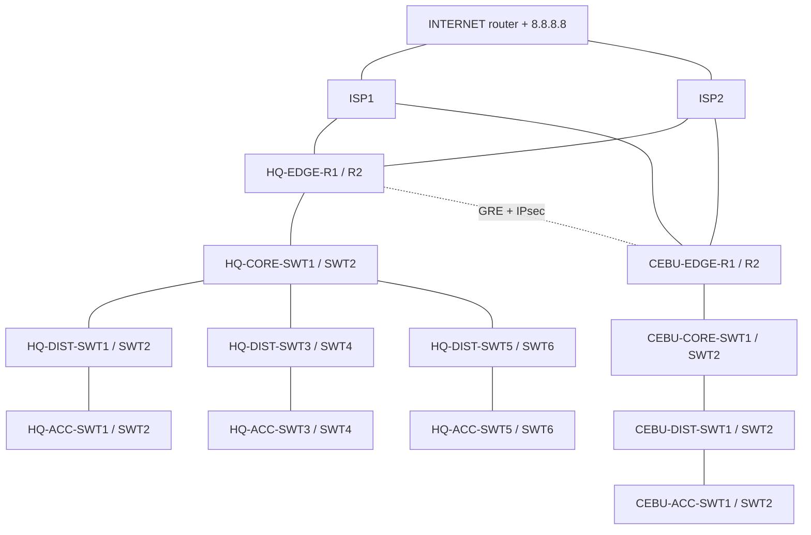

# HQ–CEBU Enterprise Network (Cisco Packet Tracer)

A two-site enterprise network lab built in Cisco Packet Tracer: a headquarters (HQ) with a collapsed-core/distribution/access design and a CEBU branch, connected by a redundant GRE + IPsec tunnel, with IP telephony, Layer 2 security, centralized logging/NTP, and SSH/SNMP management.

> **Status legend:** ✅ Implemented · 🧪 Implemented, testing limited by simulator · 📝 Designed, not verified · 🔜 Future work

**Contents:** [Overview](#1-overview) · [Naming](#2-naming-convention) · [Addressing](#3-addressing-and-vlan-plan) · [Switching](#4-switching-and-redundancy) · [Routing](#5-routing) · [Services](#6-services) · [Security](#7-security) · [Verification](#8-verification) · [Limitations](#9-known-limitations) · [Future work](#10-future-work) · [ACL details](docs/acl-policy.md)

---

## 1. Overview

| Item | Detail |
|---|---|
| Sites | HQ, CEBU |
| Tooling | Cisco Packet Tracer |
| Routing | OSPF (single area 0) |
| First-hop redundancy | HSRP, load-balanced per VLAN across distribution pairs |
| Inter-site link | Two GRE + IPsec tunnels (HQ ↔ CEBU), one per ISP path, for failover and load sharing |
| Internet access | PAT on the edge routers. Two ISP routers (ISP1, ISP2) and an INTERNET router joined by static routes, plus a Google DNS server (8.8.8.8) |
| Voice | Cisco CME on a dedicated router per site |
| Management | SSH v2 (IT subnets only), SNMP, syslog, NTP |

### High-level topology



> 📝 **TODO:** replace this with an exported Packet Tracer screenshot in `docs/images/topology.png`.

---

## 2. Naming convention

Pattern: `SITE-FUNCTION-TYPE#`, upper case, hyphen-separated. Numbering restarts at 1 for each site.

| Device | HQ | CEBU |
|---|---|---|
| Core switch | `HQ-CORE-SWT1`, `HQ-CORE-SWT2` | `CEBU-CORE-SWT1`, `CEBU-CORE-SWT2` |
| Distribution switch | `HQ-DIST-SWT1` to `HQ-DIST-SWT6` | `CEBU-DIST-SWT1`, `CEBU-DIST-SWT2` |
| Access switch | `HQ-ACC-SWT1` to `HQ-ACC-SWT6` | `CEBU-ACC-SWT1`, `CEBU-ACC-SWT2` |
| Edge router | `HQ-EDGE-R1`, `HQ-EDGE-R2` | `CEBU-EDGE-R1`, `CEBU-EDGE-R2` |
| Voice router | `HQ-CME1` | `CEBU-CME1` |
| Endpoints | `HQ-IT8`, `HQ-SALES9`, `HQ-GST-LP1` | same pattern with `CEBU-` |

Shared provider devices: `ISP1`, `ISP2`, `INTERNET`.

Loopback addressing: one `/32` per device, used as the OSPF router ID. HQ uses `1.1.1.x` and CEBU uses `2.2.2.x`: cores `.1`/`.2`, distribution switches `.11` onward, CEBU edge routers `.21`/`.22`.

---

## 3. Addressing and VLAN plan

### HQ

| VLAN | Name | Subnet | Gateway (HSRP) |
|---|---|---|---|
| 10 | MANAGEMENT | 192.168.10.0/27 | 192.168.10.1 |
| 20 | SALES | 192.168.20.0/26 | 192.168.20.1 |
| 30 | GUEST | 192.168.30.0/28 | 192.168.30.1 |
| 40 | IT | 192.168.40.0/27 | 192.168.40.1 |
| 50 | SERVER | 192.168.50.0/29 | 192.168.50.1 |
| 60 | HR | 192.168.60.0/27 | 192.168.60.1 |
| 70 | FINANCE | 192.168.70.0/26 | 192.168.70.1 |
| 80 | VOICE | 192.168.80.0/26 | 192.168.80.1 |
| 90 | CUSTOMER SUPPORT | 192.168.90.0/26 | 192.168.90.1 |
| 100 | ENGINEERING | 192.168.100.0/26 | 192.168.100.1 |
| 110 | OPERATIONS | 192.168.110.0/26 | 192.168.110.1 |
| 900 | DEVICE-MGMT | 192.168.99.0/29, .8/29, .16/29 | .1, .9, .17 |

Native VLAN on all trunks: **99**. Because VLAN 99 is used only as the native VLAN, device management uses VLAN **900**. The HSRP group number on the VLAN 900 SVIs is also 99, left over from the original plan (the group number is independent of the VLAN ID).

### CEBU

| VLAN | Name | Subnet | Gateway (HSRP) |
|---|---|---|---|
| 210 | MANAGEMENT | 192.168.210.0/28 | 192.168.210.1 |
| 220 | GUEST | 192.168.220.0/28 | 192.168.220.1 |
| 230 | IT | 192.168.230.0/28 | 192.168.230.1 |
| 240 | VOICE | 192.168.240.0/26 | 192.168.240.1 |
| 250 | SALES | 192.168.250.0/26 | 192.168.250.1 |
| 900 | DEVICE-MGMT | 192.168.99.24/29 | 192.168.99.25 |

### Device management VLAN (VLAN 900)

Each distribution pair and its access switches share one /29, so each failure domain has its own management subnet.

| Subnet | HSRP VIP | Devices |
|---|---|---|
| 192.168.99.0/29 | .1 | DIST1 (.2), DIST2 (.3), ACC1 (.4), ACC2 (.5) |
| 192.168.99.8/29 | .9 | DIST3 (.10), DIST4 (.11), ACC3 (.12), ACC4 (.13) |
| 192.168.99.16/29 | .17 | DIST5 (.18), DIST6 (.19), ACC5 (.20), ACC6 (.21) |
| 192.168.99.24/29 | .25 | CEBU-DIST1 (.26), CEBU-DIST2 (.27), CEBU-ACC1/2 (TODO) |

---

## 4. Switching and redundancy

- **Core:** `HQ-CORE-SWT1/2` are Layer 3 switches. Routed /30 links go to every distribution switch, and the two cores are joined by an LACP EtherChannel (`Port-channel2`, 10.0.0.0/30). CEBU follows the same design in miniature: `CEBU-CORE-SWT1/2` connect to `CEBU-DIST-SWT1/2` (10.13.x.0/30 and 10.14.x.0/30), to the edge routers (10.11.x.0/30 and 10.12.x.0/30) and to each other (`Port-channel2`, 10.0.1.0/30).
- **Distribution pairs:** each pair is joined by an LACP EtherChannel (`Port-channel1`) and shares VLANs through HSRP.
- **Load balancing:** STP root and HSRP active roles are split across each pair so both switches carry traffic.

| Pair | Active / STP root for | Backup for |
|---|---|---|
| DIST1 / DIST2 | DIST1: VLANs 10, 20, 900 · DIST2: VLANs 30, 40 | the other switch |
| DIST3 / DIST4 | DIST3: VLANs 50, 60, 900 · DIST4: VLANs 70, 80, 90 | the other switch |
| DIST5 / DIST6 | VLANs 100, 110, 900 (HSRP configured; TODO: add active switch per VLAN from `show standby brief`) | the other switch |
| CEBU-DIST1 / CEBU-DIST2 | CEBU-DIST1: VLANs 210, 220, 230, 900 · CEBU-DIST2: VLANs 240, 250 | the other switch |

---

## 5. Routing

- **OSPF process 1, area 0** on all core and distribution switches. Router ID equals the loopback address.
- VLAN 900 SVIs are `passive-interface`.
- **Path selection:** OSPF picks the lowest-cost path. Equal-cost paths are load-shared (ECMP). Cost can be tuned per interface with `ip ospf cost`, either to prefer one path and keep the other for failover, or to balance traffic.
- **Internal routing:** OSPF only. No internal link advertises ISP addressing.
- **ISP side:** BGP would normally be used between customer edges and providers, but it was out of scope for this project. ISP1, ISP2 and INTERNET use **static routes** instead: each ISP routes toward INTERNET, and INTERNET routes back to each ISP.

### WAN and internet design

Two independent paths, one through each ISP, so either path can fail without isolating a site.

| Link | Subnet | End A | End B |
|---|---|---|---|
| HQ-EDGE-R1 ↔ ISP1 | 203.0.113.0/30 | HQ-EDGE-R1 G0/0/2 (.1) | ISP1 G0/0/0 (.2) |
| CEBU-EDGE-R1 ↔ ISP1 | 203.0.113.4/30 | CEBU-EDGE-R1 G0/0/2 (.5) | ISP1 G0/1/0 (.6) |
| HQ-EDGE-R2 ↔ ISP2 | 203.0.113.8/30 | HQ-EDGE-R2 G0/0/2 (.9) | ISP2 G0/0/0 (.10) |
| CEBU-EDGE-R2 ↔ ISP2 | 203.0.113.12/30 | CEBU-EDGE-R2 G0/0/2 (.13) | ISP2 G0/1/0 (.14) |
| ISP1 ↔ INTERNET | 198.51.100.0/30 | ISP1 G0/2/0 (.1) | INTERNET G0/0/0 (.2) |
| ISP2 ↔ INTERNET | 198.51.100.4/30 | ISP2 G0/2/0 (.5) | INTERNET G0/1/0 (.6) |
| INTERNET ↔ Google DNS | n/a | INTERNET G0/2 | Server 8.8.8.8 |

| Tunnel | Subnet | Endpoints |
|---|---|---|
| Tunnel via ISP1 (GRE + IPsec) | 172.16.1.0/30 | .1 HQ-EDGE-R1, .2 CEBU-EDGE-R1 |
| Tunnel via ISP2 (GRE + IPsec) | 172.16.2.0/30 | .1 HQ-EDGE-R2, .2 CEBU-EDGE-R2 |

The 203.0.113.0/24 and 198.51.100.0/24 ranges are reserved for documentation (RFC 5737), so they are safe to use as simulated public addressing.

- **Inter-site:** OSPF runs over both GRE tunnels. With equal costs, traffic is load-shared across both. Raising the cost on one tunnel makes it a backup instead.
- **Internet:** PAT on the edge routers, so internal hosts reach 8.8.8.8 through whichever ISP path is active.
- **Note on GRE:** each edge must reach the other site's public (ISP-facing) address through its static/default route, not through the tunnel. Otherwise the tunnel's own traffic would try to route through itself and the tunnel would flap.

### Site-to-site VPN (GRE over IPsec)

- Each tunnel is a GRE interface (`Tunnel0`) between the two edge routers' ISP-facing addresses. IPsec protects the GRE packets: a crypto map on the ISP-facing interface matches GRE traffic between the two public endpoints (ACL 100).
- **ISAKMP (phase 1):** AES, pre-shared key authentication, Diffie-Hellman group 2. **IPsec (phase 2):** transform set ESP-AES + ESP-SHA-HMAC. Each path has its own key (not published, see the note in section 11).
- OSPF runs over the tunnel (172.16.x.0/30). Each edge router has a static default route to its ISP and advertises it into OSPF (`default-information originate`), so internal routers learn two equal-cost default paths.
- **PAT:** the `NAT-INSIDE` ACL translates the CEBU Guest (220), IT (230) and Sales (250) subnets to the ISP-facing address (`overload`). Traffic to internal ranges (10.0.0.0/8, 172.16.0.0/12, 192.168.0.0/16) is never translated, so inter-site traffic keeps its real addresses. TODO: Management (210) is not in this list, so add it if it should reach the internet.

| Item | CEBU-EDGE-R1 | CEBU-EDGE-R2 |
|---|---|---|
| Loopback (router ID) | 2.2.2.21 | 2.2.2.22 |
| Links to core | Gi0/0/0 10.11.1.2/30 (CEBU-CORE-SWT1), Gi0/0/1 10.11.2.2/30 (second core, TODO confirm) | Gi0/0/0 10.12.1.2/30 (CEBU-CORE-SWT1), Gi0/0/1 10.12.2.2/30 (second core, TODO confirm) |
| ISP link | Gi0/0/2 203.0.113.5/30 to ISP1 (.6) | Gi0/0/2 203.0.113.13/30 to ISP2 (.14) |
| Default route | Static via 203.0.113.6 | Static via 203.0.113.14 |
| Tunnel0 | 172.16.1.2/30 to 203.0.113.1 (HQ-EDGE-R1) | 172.16.2.2/30 to 203.0.113.9 (HQ-EDGE-R2) |
| IPsec | Transform set TSET1, crypto map CMAP1 | Transform set TSET2, crypto map CMAP2 |

> 📝 **TODO:** add the HQ edge router configs (the mirror of the table above) and the ISP1, ISP2 and INTERNET static routes.

---

## 6. Services

### DHCP: split scope (80/20) on the distribution switches

**Why:** the original plan was centralized DHCP. In Packet Tracer, queue congestion and delays meant clients often did not receive addresses in time (suspected cause: simulator load and slow simulation clock). DHCP was moved onto the distribution switches.

**How:** the switch that is HSRP-active for a VLAN holds about 80% of the pool (`PRIMARY`), and its partner holds the remaining 20% (`SECONDARY`). If the primary fails, the secondary can still hand out addresses while the primary is restored. The pools are kept from overlapping with `ip dhcp excluded-address`.

| VLAN | Primary switch | Primary range | Secondary range |
|---|---|---|---|
| 10 | DIST1 | .4 – .25 | .26 – .30 (DIST2) |
| 20 | DIST1 | .4 – .50 | .51 – .62 (DIST2) |
| 30 | DIST2 | .4 – .12 | .13 – .14 (DIST1) |
| 40 | DIST2 | .4 – .25 | .26 – .30 (DIST1) |
| 60 | DIST3 | .4 – .25 | .26 – .30 (DIST4) |
| 70 | DIST4 | .4 – .50 | .51 – .62 (DIST3) |
| 90 | DIST4 | .4 – .50 | .51 – .62 (DIST3) |
| 80 (voice) | HQ-CME1 | .5 – .62 | n/a |
| CEBU 210 | CEBU-DIST1 | .4 – .12 | .13 – .14 (CEBU-DIST2) |
| CEBU 220 | CEBU-DIST1 | .4 – .12 | .13 – .14 (CEBU-DIST2) |
| CEBU 230 | CEBU-DIST1 | .4 – .12 | .13 – .14 (CEBU-DIST2) |
| CEBU 250 | CEBU-DIST2 | .4 – .50 | .51 – .62 (CEBU-DIST1) |
| CEBU 240 (voice) | CEBU-CME1 | TODO | n/a |

### Telephony (CME)

Packet Tracer supports telephony only on specific router models, so `HQ-CME1` (Cisco 2811) and `CEBU-CME1` run Cisco Unified CME and provide phone registration, call routing and the voice VLAN DHCP pool (with option 150 pointing to the CME).

- HQ extensions: 1010–1017 (8 phones, type 7960)
- Inter-site calls: VoIP dial-peer from HQ pointing at the CEBU CME

### NTP and syslog

- Server: `192.168.50.4` (SERVER VLAN). NTP uses MD5 authentication.
- All devices send syslog (trap level debugging) to the same server.

---

## 7. Security

### Layer 2

| Feature | Status | Notes |
|---|---|---|
| Port security | ✅ | Sticky MAC, violation mode `restrict` on access ports |
| DHCP snooping | ✅ | Trusted on uplinks only, rate limit per access port |
| Dynamic ARP Inspection | 🔜 | Planned. Depends on DHCP snooping, and Packet Tracer performance is the main concern |
| Native VLAN 99 on trunks | ✅ | Separate from user VLANs |

### Management access

- **SSH v2 only** (`transport input ssh`, `login local`). Telnet is disabled.
- **VTY access-class `SSH-ALLOW`** restricts SSH to the IT subnet (HQ: 192.168.40.0/27).
- Management IPs live in VLAN 900 SVIs, separate from user traffic.
- **Policy:** HQ IT can administer devices at both sites. CEBU IT can administer CEBU only. In practice, this means HQ devices permit HQ IT, and CEBU devices permit CEBU IT plus HQ IT.

### SNMP

| Setting | Value |
|---|---|
| Version | v2c (Packet Tracer limitation) |
| Access | Read-only community, restricted by ACL to the monitoring server and IT subnet |
| Traps | Sent to 192.168.50.4 |

Reference config for switches and routers (replace the placeholder string, never commit the real one):

```
ip access-list standard SNMP-ALLOW
 permit host 192.168.50.4
 permit 192.168.40.0 0.0.0.31
!
snmp-server community <RO-COMMUNITY> RO SNMP-ALLOW
snmp-server location HQ
snmp-server contact network-admin@hq.local
snmp-server host 192.168.50.4 version 2c <RO-COMMUNITY>
snmp-server enable traps
```

> ⚠️ **Security note:** only `HQ-CME1 and both HQ-EDGE-R1/2` has SNMP configured so far. Based on my observations, the multilayer switches accept SNMP commands but do not appear to function properly with SNMP. However, this observation does not conclusively indicate that the issue is a Cisco Packet Tracer limitation. There may be other contributing factors, but I suspect network congestion could be one of them. In Simulation Mode, I observed that packets arriving at the distribution switch (DIST-SWT) were dropped due to missing ARP information or issues with ARP processing and packet queuing. These conditions appeared to contribute to packet drops in several instances. In SNMP v1/v2c, a community string works like a password sent in clear text. A **read-only (RO)** community lets a monitoring system read status and counters. A **read-write (RW)** community lets anyone who knows the string *change* settings, such as shutting down an interface, and the string used here (`HQCME1_RW`) is easy to guess. Nothing in this network needs to write through SNMP, so by least privilege the RW community is removed and the RO community is restricted by ACL:
>
> ```
> no snmp-server community HQCME1_RW RW
> no snmp-server community HQCME1 RO
> snmp-server community <RO-COMMUNITY> RO SNMP-ALLOW
> ```

### Access control lists (inter-VLAN policy)

Principle: **least privilege**. Each VLAN reaches only what its function requires. ACLs are stateless, so rules control who may start a connection and replies must also be permitted. They are applied inbound on the SVI of the originating VLAN on both switches of a pair, so they persist after an HSRP failover. Inter-site rules are written into the same VLAN ACLs by permitting or denying the other site's subnets.

**Guest ACL (`GUEST-IN`):**
- Permits DHCP, blocks all RFC 1918 internal ranges, loopbacks and WAN addressing, and permits everything else, so guests get internet only.
- Tested working for HQ (VLAN 30) and CEBU (VLAN 220). Evidence: `docs/images/guest-acl-*.png`.
- Applied on the guest SVIs (VLAN 30 and VLAN 220). Packet Tracer's multilayer switch does not display `ip access-group` lines under SVIs in the running-config, so enforcement is shown by test screenshots and the `show access-lists` match counters instead.

**Inter-VLAN policy:** the policy below is implemented as one ACL per VLAN. The full rules, where each one is applied, and the status of each are in [`docs/acl-policy.md`](docs/acl-policy.md). Anything not listed under "Can initiate to" is denied.

| VLAN | Can initiate to | Notable blocks (everything else not listed is also denied) |
|---|---|---|
| IT | Everything, including VLAN 900 | nothing |
| Management | Server, Sales, Finance, HR, Support, Engineering, Operations | Voice, VLAN 900 |
| Server | Replies to requests (TCP, DNS, NTP, ping); optional SNMP polling of VLAN 900 | Starting any other connection to user VLANs |
| Sales | Server, Customer Support | HR, Finance, Engineering, Operations, Management |
| Customer Support | Server, Sales | HR, Finance, Engineering, Operations |
| HR / Finance | Server | All other user VLANs |
| Engineering / Operations | Server, each other | HR, Finance, Sales, Support |
| Voice | Voice only | All data VLANs |
| Guest | Internet only | Everything internal |

CEBU follows the same model for its VLANs. Between sites: HQ IT can manage everything, CEBU IT only CEBU, Management–Management and Voice–Voice are allowed, and guest traffic never crosses the tunnel.

---

## 8. Verification

| Test | Expected | Result | Evidence |
|---|---|---|---|
| DHCP on each VLAN | Client gets an address from the correct pool | ✅ | `docs/images/dhcp-*.png` |
| HSRP state | One Active and one Standby per VLAN | ✅ | `docs/images/hsrp-standby-brief-*.png` |
| HSRP failover | Gateway stays reachable when the active switch fails | Not tested | n/a |
| SSH from IT | Login succeeds | ✅ | `docs/images/ssh-it.png` |
| SSH from non-IT VLAN | Refused | TODO | `docs/images/ssh-denied.png` |
| Guest isolation | Guest reaches internet, not internal VLANs | ✅ | `docs/images/guest-acl-*.png` |
| Inter-VLAN ACL policy | Ping matrix per VLAN as listed in `docs/acl-policy.md` | TODO | `docs/images/acl-*.png` |
| HQ ↔ CEBU over tunnel | Ping succeeds | ✅ | `docs/images/tunnel-ping.png` |
| PAT to internet | Internal host reaches 8.8.8.8 | ✅ | `docs/images/pat-*.png` |

> Add screenshots under `docs/images/` and link them in this table.

---

## 9. Known limitations

- **Packet Tracer performance:** during final testing, most packets were dropped because of queue exhaustion, which prevented full verification. Troubleshooting included temporarily shutting down non-essential interfaces and disabling CDP/LLDP. Neither helped, so CDP/LLDP were re-enabled. The simulation clock also appeared to advance slowly.
- **ACLs on SVIs are not visible in the running-config.** Packet Tracer's multilayer switch applies `ip access-group` on an SVI but does not show the line in `show running-config`. The ACLs were verified through test screenshots and `show access-lists` counters rather than the saved configuration.
- **Inter-VLAN ACLs** are written for every VLAN (see `docs/acl-policy.md`), but end-to-end testing was limited by the simulator, so only the tests marked ✅ in section 8 are claimed as verified.
- Packet Tracer's ISA 3000 firewall is a limited ASA (no bridge-group/transparent support, no DHCP relay), so it was not used for guest isolation. Guest filtering is done with ACLs on the distribution SVIs.

## 10. Future work

- Dynamic ARP Inspection
- BGP for the dual-homed ISP/WAN links
- Verify the full inter-VLAN ACL policy end-to-end when simulator performance allows
- A dedicated security device (firewall) in a second, working topology
- SNMPv3 (adds authentication and encryption, but Packet Tracer does not support it on most devices) and AAA (TACACS+/RADIUS) with per-admin accounts
- Jump host in VLAN 900 for device management

---

## 11. Repository layout

```
.
├── README.md
├── docs/
│   ├── acl-policy.md      # every ACL, where it is applied, and its status
│   └── images/            # topology and test screenshots
├── configs/
│   ├── hq/                # sanitized running-configs
│   └── cebu/
├── scripts/
│   └── sanitize_config.py # redacts secrets from configs before publishing
└── network.pkt            # Packet Tracer file
```

> 🔒 **Before committing configs:** run `python3 scripts/sanitize_config.py <input> <output>` to redact password hashes, NTP keys, IPsec pre-shared keys, SNMP community strings and serial numbers, then review the result by hand.
